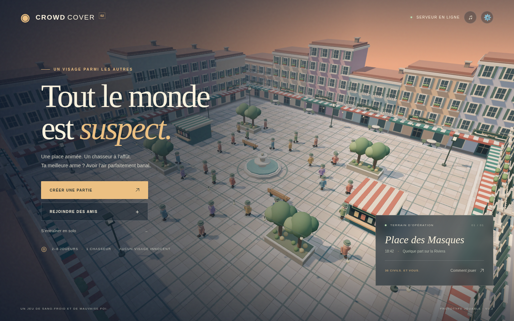

# Crowd Cover · Place des Masques



Un jeu de cache-cache multijoueur dans une foule, en 3D et dans le navigateur. Un chasseur observe les passants en première personne ; les infiltrés jouent en troisième personne et imitent la foule pour rester cachés.

La place est construite avec Three.js : fontaine, commerces, terrasses, éclairage du soir et personnages animés. Le son est synthétisé dans le navigateur : ambiance, fontaine, pas et actions. Aucun téléchargement de modèles, compte de jeu ou clé API n'est nécessaire.

## Jouer sur Windows

Prérequis : [Node.js 22 ou plus récent](https://nodejs.org/) et [Git pour Windows](https://git-scm.com/downloads/win), puis un navigateur de bureau récent avec l'accélération graphique activée. Après l'installation de Git, ferme et rouvre le terminal.

### Première installation

Dans l'invite de commandes Windows, lance chaque commande séparément :

```bat
cd /d "%USERPROFILE%"
git clone https://github.com/DanylLeStyle/gameTestCodex.git
cd gameTestCodex
npm ci
npm start
```

Ouvre ensuite **http://localhost:3000** et laisse le terminal ouvert. Tous les fichiers du jeu sont maintenant sur ton PC ; tu ne retélécharges plus d'archive à chaque mise à jour.

### Mettre à jour une installation existante

Arrête le serveur avec **Ctrl+C**, puis, depuis le dossier du jeu :

```bat
git pull
npm ci
npm start
```

Si tu as fermé le terminal et cloné le projet dans ton dossier utilisateur comme ci-dessus, commence par :

```bat
cd /d "%USERPROFILE%\gameTestCodex"
```

Recharge ensuite le navigateur. Si `git pull` signale des modifications locales, conserve-les avant de poursuivre ; ne les efface pas pour forcer la mise à jour.

## Créer une vraie partie multijoueur

1. Un joueur choisit **Créer une partie** dans le menu.
2. Il partage le code de cinq caractères ou le lien d'invitation.
3. Les autres ouvrent **la même adresse de serveur**, choisissent **Rejoindre des amis** et entrent le code.
4. L'hôte lance la manche quand tout le monde est là. Un salon accueille **2 à 8 joueurs**. Les rôles tournent à chaque manche.

Chaque salon possède sa foule et sa manche ; les actions et déplacements sont calculés par le serveur et transmis à ses joueurs par WebSocket à 20 Hz. Ouvrir deux onglets permet de vérifier les deux rôles sur un seul PC.

**Un code de salon ne relie pas des serveurs différents.** Si chacun lance `npm start` sur son propre PC et ouvre `localhost`, chacun rejoint son propre serveur.

- **Sur le même réseau local :** un seul PC lance le serveur. Son propriétaire tape `ipconfig` et relève l'adresse IPv4 de sa connexion, par exemple `192.168.1.42`. Les autres ouvrent `http://192.168.1.42:3000`. Le pare-feu Windows doit autoriser Node.js sur le réseau privé.
- **À distance par Internet :** déploie une seule instance du serveur avec HTTPS et WebSocket. Tous les amis utilisent son URL publique. Aucun lancement de Node.js ni réglage de box n'est alors nécessaire chez les joueurs.

`localhost` désigne toujours l'appareil de la personne qui ouvre le lien : ne le partage pas avec un ami sur un autre PC. Le bouton d'invitation signale ce cas.

## Héberger sur Render

Le dépôt contient un [Blueprint Render](render.yaml). Il configure un service Node.js, `npm ci`, `npm start` et la vérification `/health`. Ce fichier **ne déploie rien tout seul**.

[](https://render.com/deploy?repo=https://github.com/DanylLeStyle/gameTestCodex)

1. Ouvre le lien **Déployer sur Render** et connecte ton compte GitHub si Render le demande. Si le dépôt est privé, donne uniquement l'accès nécessaire à ce dépôt.
2. Vérifie le service proposé par le Blueprint et l'offre **Free** avant de confirmer. L'offre gratuite suffit pour essayer le prototype, si elle est disponible sur ton compte.
3. Une fois le déploiement terminé, Render affiche l'URL HTTPS du service. Ouvre cette URL, crée un salon et partage le lien avec tes amis.
4. Les futurs commits sur la branche reliée au service peuvent déclencher un nouveau déploiement selon les réglages Render. Un redéploiement coupe les parties en cours.

Un service gratuit peut s'endormir et demander un délai au premier chargement. Les salons vivent en mémoire et disparaissent quand le processus redémarre. Le jeu nécessite **un service web Node.js persistant**, compatible avec WebSocket : **GitHub Pages seul ne peut pas héberger le serveur**. Le serveur utilise le port fourni par l'hébergeur dans `PORT` ; sa valeur locale par défaut est `3000`.

Aucun hébergement public n'est créé automatiquement par le projet. Les conditions et disponibilités de l'hébergement gratuit dépendent de Render.

## Commandes et règles

Clique sur **Entrer en jeu** pour capturer la souris. **Échap** la libère et ouvre le menu ; la partie continue pendant ce menu.

| Action                                  | Commande                                      |
| --------------------------------------- | --------------------------------------------- |
| Avancer, gauche, reculer, droite        | ZQSD sur AZERTY / WASD sur QWERTY, ou flèches |
| Regarder                                | Souris                                        |
| Courir                                  | Maj maintenue                                 |
| Chasseur : démasquer le personnage visé | Clic gauche                                   |
| Chasseur : onde de panique              | G                                             |
| Infiltré : imiter une discussion        | E maintenu                                    |
| Infiltré : imiter la panique            | Espace maintenue                              |
| Infiltré : diversion                    | F                                             |
| Menu / libérer la souris                | Échap                                         |

Les déplacements utilisent les **positions physiques des touches** : les mêmes quatre touches correspondent à ZQSD sur AZERTY et WASD sur QWERTY. Le réglage clavier adapte les indications à l'écran.

La manche commence par **5 secondes de dispersion** : les infiltrés peuvent se placer, le chasseur attend. La traque dure ensuite **3 minutes**, avec **36 civils**.

- **Chasseur :** lance une onde devant toi pour faire paniquer les civils dans un rayon de huit mètres. Observe ceux qui réagissent mal, vise et capture-les. L'onde se recharge en dix secondes ; les captures sont limitées en cadence et bloquées par les obstacles. Un civil touché ajoute **10 secondes** au temps des infiltrés. À la **troisième erreur**, le chasseur perd.
- **Infiltré :** marche à la vitesse de la foule, imite ses pauses et réactions. La panique ne se déclenche pas automatiquement pour toi. La diversion attire brièvement les civils voisins et se recharge en vingt secondes. Survis jusqu'à la fin du chronomètre ; une fois repéré, tu peux observer la suite de la manche.
- Le chasseur gagne quand tous les infiltrés sont capturés. Si le chasseur quitte pendant la manche, les infiltrés gagnent. L'hôte peut relancer une manche depuis les résultats.

Les discussions sont des animations d'imitation, pas un chat vocal.

## Entraînement et paramètres

**S'entraîner en solo** ouvre une session de chasseur avec trois suspects parmi les civils. Ils réagissent plus tard aux ondes de panique : utilise cette différence pour les repérer. Ce mode ne remplace pas une partie contre des joueurs humains.

Le bouton **⚙** règle le pseudo pour le prochain salon, la disposition clavier affichée, la sensibilité, le volume, la qualité graphique et l'inversion verticale. Les réglages restent enregistrés dans ce navigateur. La souris n'est pas inversée par défaut. Le bouton **♫** coupe ou réactive le son ; le navigateur attend un clic de ta part avant de l'autoriser.

## Développement et vérification

```sh
npm ci
npm test
npm start
```

`npm test` lance les tests de simulation et de serveur réseau. Pour les tests de parcours dans Chromium :

```sh
npx playwright install chromium
npm run test:browser
```

Ils ouvrent deux sessions indépendantes, créent un salon, rejoignent une manche, vérifient les deux rôles, les mouvements, l’orientation de la souris, l’onde et la sortie audio. Les captures d’écran sont écrites dans `test-results/`. Avec un Chromium déjà installé, on peut fournir son chemin dans `CHROMIUM_PATH`.

`/health` fournit un contrôle HTTP sans authentification. Le serveur HTTP et WebSocket partage un même port. Aucun service externe, secret ou base de données n'est requis.

Pour une vérification manuelle complète, ouvre deux navigateurs sur le même serveur : crée un salon, rejoins-le avec son code, lance une manche et vérifie les deux caméras, la capture de souris, les déplacements, les sons, l'onde, la capture et la fin de manche. Teste aussi avec un second ordinateur pour vérifier l'accès réseau de ton installation.

| Fichier                | Rôle                                              |
| ---------------------- | ------------------------------------------------- |
| `server.js`            | HTTP, WebSocket, salons et connexions             |
| `game.js`              | Simulation autoritaire, foule et règles de manche |
| `public/world-data.js` | Obstacles et collisions partagés                  |
| `public/scene.js`      | Décor 3D, caméras, personnages et effets          |
| `public/audio.js`      | Ambiance et effets Web Audio                      |
| `public/client.js`     | Menus, commandes, état réseau et interface        |
| `render.yaml`          | Configuration de déploiement Render               |

## Limites actuelles

Prototype de bureau pour clavier et souris : pas de contrôles tactiles ou manette. Pas de comptes, matchmaking public, chat vocal, reconnexion à une identité ou sauvegarde des scores. Les nouveaux joueurs attendent la fin d'une manche déjà commencée. Les mouvements sont interpolés, mais il n'y a pas encore de prédiction réseau ou de compensation de latence avancée. Le serveur valide les actions et déplacements ; ce n'est pas un système anti-triche de production.

Les personnages, mouvements et sons sont procéduraux. Le côté « goofy » repose sur leurs animations de panique et de capture : **pas encore de ragdolls ou de simulation physique des corps**. Les Blueprints Unreal et les assets du précédent projet ne sont pas importés. Les salons étant stockés dans un seul processus, ne déploie pas plusieurs instances derrière un répartiteur sans ajouter une architecture de sessions adaptée.
